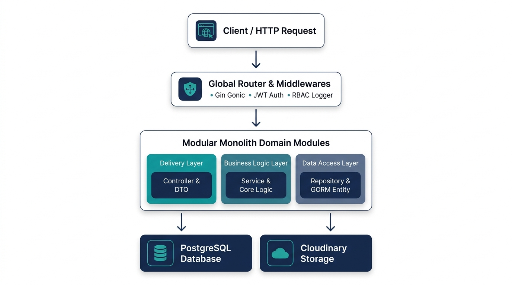
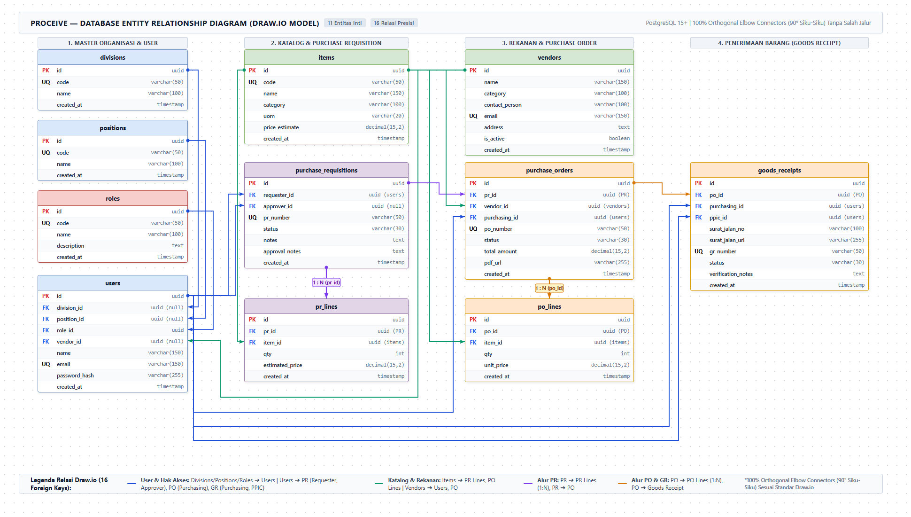
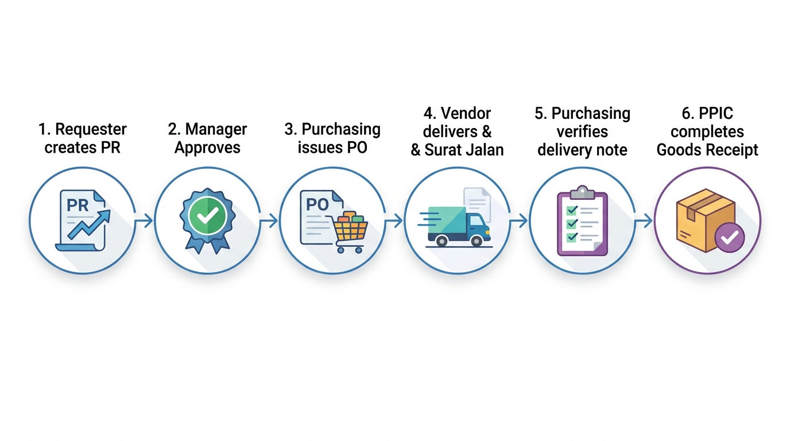

# Proceive (Procure-to-Receive)

> REST API backend untuk mengelola seluruh alur pengadaan barang (procure-to-receive) perusahaan, mulai dari pengajuan internal oleh karyawan, persetujuan manajer divisi, penerbitan PO otomatis beserta dokumen PDF resmi, kolaborasi vendor, hingga verifikasi penerimaan fisik barang di gudang.

Dibuat oleh **Nito Aldi Fitrian** — Final Project Bootcamp Golang SanberCode, Oktober 2026.

[](https://golang.org)
[](https://gin-gonic.com)
[](https://www.postgresql.org)
[](#arsitektur)
[](#daftar-endpoint)

---

## 📑 Daftar Isi

- [Masalah yang Diselesaikan](#masalah-yang-diselesaikan)
- [Fitur](#fitur)
- [Tech Stack](#tech-stack)
- [Arsitektur](#arsitektur)
- [Skema Database](#skema-database)
- [Aturan Bisnis](#aturan-bisnis)
- [Autentikasi & Role](#autentikasi--role)
- [Daftar Endpoint](#daftar-endpoint)
- [Format Response](#format-response)
- [Cara Pakai (Alur Demo)](#cara-pakai-alur-demo)
- [Menjalankan di Lokal](#menjalankan-di-lokal)
- [Deployment](#deployment)
- [Keputusan Desain](#keputusan-desain)
- [Keterbatasan & Pengembangan Berikutnya](#keterbatasan--pengembangan-berikutnya)

---

## Masalah yang Diselesaikan

Proses pengadaan barang di banyak perusahaan masih dilakukan secara manual:

1. **Persetujuan Masih Pakai Kertas:** Pengajuan barang menggunakan formulir fisik dan tanda tangan basah. Proses tertunda lama jika manajer sedang bertugas di luar kantor.
2. **Status Pengajuan Sulit Dilacak:** Karyawan pemohon tidak tahu apakah pengajuannya sudah disetujui, sedang diproses purchasing, atau ditolak.
3. **Risiko Salah Terima Barang di Gudang:** Tim gudang (PPIC) tidak memegang rincian PO saat kurir tiba, sehingga rawan salah verifikasi spesifikasi atau jumlah barang.
4. **Surat Jalan Fisik Sering Hilang:** Dokumen surat jalan dari vendor mudah terselip atau rusak, menyulitkan rekonsiliasi saat audit pengadaan.

Proceive memindahkan seluruh alur kerja ini ke dalam satu sistem digital terpusat agar tercatat rapi, transparan, dan mudah dilacak.

---

## Fitur

- **Autentikasi & RBAC (6 Role):** Akses berbasis token JWT untuk 6 peran: Admin, Requester, Approver, Purchasing, PPIC (Gudang), dan Vendor.
- **Master Organisasi & User:** Manajemen data divisi, jabatan, pengguna internal kantor, dan akun login portal vendor.
- **Katalog Barang & Rekanan:** Data master item (kode SKU, nama barang, satuan/UOM, estimasi harga) serta direktori profil rekanan vendor.
- **Purchase Requisition (PR):** Pengajuan kebutuhan barang multi-item; staf hanya bisa melihat daftar PR miliknya sendiri.
- **Approval Berjenjang per Divisi:** Manajer divisi hanya bisa menyetujui atau menolak permohonan staf dari divisinya sendiri.
- **Penerbitan Purchase Order (PO):** Purchasing menerbitkan PO dari PR yang sudah disetujui, memilih vendor, dan sistem menghitung total biaya secara otomatis.
- **Generator PDF Purchase Order Native:** Mencetak dokumen resmi PO standar PDF 1.4 langsung dari kode Go tanpa ketergantungan runtime browser headless.
- **Portal Khusus Rekanan Vendor:** Vendor memiliki akun sendiri untuk melihat PO yang ditujukan kepada mereka dan mengunggah dokumen digital Surat Jalan.
- **Upload Dokumen Surat Jalan ke Cloud:** Berkas bukti pengiriman (PDF atau gambar) diunggah langsung ke Cloudinary, dilengkapi fallback penyimpanan disk lokal.
- **Verifikasi Penerimaan Dua Tahap:**
  - *Tahap Administratif:* Purchasing memeriksa kesesuaian dokumen Surat Jalan vendor (`SJ_APPROVED` atau `SJ_REVISED`).
  - *Tahap Fisik:* Tim PPIC/gudang memeriksa fisik barang saat tiba di gudang dan mengonfirmasi penerimaan resmi (`GR_COMPLETED`).
- **Dokumentasi API Interaktif:** Halaman dokumentasi OpenAPI 3.0 via Scalar UI di rute `/docs`.

---

## Tech Stack

| Komponen | Teknologi | Keterangan |
|---|---|---|
| **Bahasa Pemrograman** | **Go (Golang) v1.26.4** | Bahasa backend utama berkinerja tinggi |
| **HTTP Framework** | **Gin Gonic v1.12.0** | Routing, middleware, dan request validation |
| **Database** | **PostgreSQL 15+** | Database relasional data master dan transaksi |
| **ORM & Driver** | **GORM v1.31.2 & pgx/v5** | Pemetaan objek database dan query builder |
| **Autentikasi** | **golang-jwt v5.3.1** | Penandatanganan dan validasi token JWT |
| **Enkripsi Password** | **Bcrypt (x/crypto v0.58.0)** | Hashing password akun pengguna |
| **Cloud Storage** | **Cloudinary Go SDK v2.16.1** | Penyimpanan berkas digital Surat Jalan vendor |
| **Dokumen PDF** | **Native Go PDF Engine** | Generator PDF PO standar 1.4 tanpa browser external |
| **Dokumentasi API** | **Scalar UI & OpenAPI 3.0** | Tampilan UI dokumentasi interaktif di endpoint `/docs` |
| **Development Tool** | **Air** | Live reload server otomatis saat coding lokal |

---

## Arsitektur

Proceive menggunakan pendekatan **Modular Monolith** dengan **Clean Layered Architecture** pada setiap modul domainnya. Setiap modul terisolasi di dalam foldernya masing-masing (`internal/modules/`):



### Alasan Menggunakan Modular Monolith:
- **Kode Tidak Saling Mengganggu:** Tiap domain (PR, PO, Vendor, GR) punya folder layernya sendiri. Mengubah logika di modul PO tidak akan merusak modul User atau Auth.
- **Deploy & Perawatan Simpel:** Cukup satu aplikasi binary dan satu database PostgreSQL. Tidak ada beban operasional antar-service atau network latency seperti di microservices.
- **Debugging Jauh Lebih Cepat:** Alur data dan log error berada di satu project yang sama, penelusuran masalah langsung tertuju ke modul terkait.
- **Mudah Dipecah di Masa Depan:** Jika sewaktu-waktu ada modul yang ingin dipisah menjadi microservice mandiri, kodenya sudah terisolasi dan siap dipindahkan tanpa merombak ulang sistem.

### Struktur Lapisan per Modul:
1. **Delivery Layer (`controller.go` & `route.go`):** Menangani HTTP Request, parsing DTO payload, dan mengirimkan response JSON standar.
2. **Business Logic Layer (`service.go`):** Menjalankan aturan bisnis (validasi divisi pemohon, kalkulasi harga, pemanggilan Cloudinary, dan generator PDF).
3. **Data Access Layer (`repository.go` & `entity.go`):** Menjalankan transaksi query data ke PostgreSQL via GORM.
4. **Data Transfer Objects (`dto.go`):** Struct validasi input request payload dengan tag binding Gin.

---

## Skema Database

Database menggunakan PostgreSQL dengan 11 entitas inti dan 16 relasi foreign key presisi:



### Rangkuman 11 Entitas:
- **Master Organisasi & User:**
  - `divisions`: Master data divisi (IT, HRD, Produksi, Purchasing, Finance, PPIC).
  - `positions`: Tingkatan jabatan (Staff, Supervisor, Manager, Director).
  - `roles`: Hak akses peran (Admin, Requester, Approver, Purchasing, PPIC, Vendor).
  - `users`: Akun login internal kantor dan portal vendor.
- **Katalog & Rekanan:**
  - `items`: Master katalog barang, kode SKU, kategori, satuan (UOM), dan estimasi harga.
  - `vendors`: Data profil rekanan vendor dan kontak person.
- **Transaksi Pengadaan:**
  - `purchase_requisitions`: Dokumen pengajuan pembelian dari karyawan beserta riwayat approval.
  - `pr_lines`: Rincian item barang dan kuantitas yang diajukan dalam satu PR.
  - `purchase_orders`: Dokumen pesanan pembelian resmi hasil konversi PR ke vendor terpilih.
  - `po_lines`: Rincian item barang, kuantitas, dan harga satuan dalam PO.
  - `goods_receipts`: Catatan penerimaan barang, nomor surat jalan, berkas bukti kirim Cloudinary, dan status verifikasi gudang.


---

## Aturan Bisnis

1. **Approval Terbatas per Divisi:**
   - Manajer divisi (*Approver*) hanya bisa menyetujui atau menolak dokumen PR yang diajukan oleh staf dari divisinya sendiri.
   - Staf (*Requester*) hanya bisa melihat daftar PR miliknya sendiri.
2. **Siklus Status Purchase Requisition (PR):**
   - `DRAFT` ➔ Pemohon menyusun item barang.
   - `PENDING_APPROVAL` ➔ Diajukan ke manajer divisi.
   - `APPROVED` ➔ Disetujui manajer (siap dibuatkan PO oleh purchasing).
   - `REJECTED` ➔ Ditolak manajer divisi beserta catatan penolakan.
3. **Penerbitan Dokumen Purchase Order (PO):**
   - PO hanya bisa diterbitkan dari PR yang sudah berstatus `APPROVED`.
   - Penerbitan PO otomatis menghasilkan nomor unik dan dokumen PDF resmi.
   - Rekanan vendor hanya bisa melihat PO yang ditujukan kepada perusahaannya.
4. **Verifikasi Penerimaan Barang Dua Tahap:**
   - Vendor mengirimkan barang dan mengunggah dokumen digital Surat Jalan ke portal.
   - Purchasing memeriksa dokumen Surat Jalan terhadap rincian PO (`SJ_APPROVED` atau `SJ_REVISED`).
   - Tim gudang (PPIC) memeriksa fisik barang saat tiba di gudang. Penerimaan disahkan dengan status `GR_COMPLETED` dan nomor GR resmi.

---

## Autentikasi & Role

Autentikasi menggunakan **Bearer Token JWT** yang dikirimkan pada HTTP Header:
```http
Authorization: Bearer <token_jwt>
```

### Matriks 6 Role Sistem:

| Role | Penjelasan & Wewenang |
|---|---|
| `ADMIN` | Akses penuh ke seluruh master data (user, divisi, jabatan, katalog), konfigurasi sistem, dan audit transaksi. |
| `REQUESTER` | Staf kantor yang membuat pengajuan kebutuhan barang (PR) dan memantau status persetujuannya. |
| `APPROVER` | Manajer divisi yang memeriksa dan memutuskan (*Approve / Reject*) permohonan PR staf di divisinya. |
| `PURCHASING` | Mengelola katalog barang/vendor, menerbitkan PO resmi dari PR yang approved, dan memverifikasi dokumen Surat Jalan. |
| `PPIC` | Tim gudang/logistik yang memeriksa fisik barang saat tiba dan menyelesaikan penerimaan (*Goods Receipt*). |
| `VENDOR` | Mitra rekanan yang login ke portal untuk melihat PO aktif dan mengunggah dokumen Surat Jalan bukti pengiriman. |

---

## Daftar Endpoint

Dokumentasi interaktif dapat dibuka langsung di browser:
👉 **`http://localhost:8080/docs`** *(Scalar UI OpenAPI 3.0)*

### Rangkuman Endpoint Utama:

| Modul | Method | URL Path | Hak Akses | Keterangan |
|---|---|---|---|---|
| **Health & Docs** | `GET` | `/health` | Public | Cek koneksi server dan PostgreSQL |
| | `GET` | `/docs` | Public | Tampilan dokumentasi interaktif Scalar UI |
| **Auth** | `POST` | `/api/v1/auth/login` | Public | Login pengguna / vendor & dapatkan token JWT |
| | `GET` | `/api/v1/auth/me` | Protected | Ambil profil pengguna yang sedang login |
| | `POST` | `/api/v1/auth/logout` | Protected | Logout dan pembersihan sesi |
| **Master Divisi** | `GET` | `/api/v1/divisions` | Protected | Daftar divisi kantor |
| | `POST` | `/api/v1/divisions` | Admin | Tambah divisi baru |
| **Master Jabatan** | `GET` | `/api/v1/positions` | Protected | Daftar jabatan pegawai |
| | `POST` | `/api/v1/positions` | Admin | Tambah jabatan baru |
| **Master User** | `GET` | `/api/v1/users` | Admin | Daftar seluruh akun pengguna |
| | `POST` | `/api/v1/users` | Admin | Daftarkan user staf atau akun vendor baru |
| **Katalog Barang** | `GET` | `/api/v1/items` | Protected | Ambil katalog master barang |
| | `POST` | `/api/v1/items` | Admin, Purchasing | Tambahkan barang baru ke katalog |
| **Katalog Vendor** | `GET` | `/api/v1/vendors` | Protected | Daftar rekanan vendor aktif |
| | `POST` | `/api/v1/vendors` | Admin, Purchasing | Tambah profil vendor & akun login portal |
| **Purchase Requisition** | `GET` | `/api/v1/purchase-requisitions` | Protected | Daftar PR (otomatis terfilter per divisi/user) |
| | `POST` | `/api/v1/purchase-requisitions` | Requester, Approver, Admin | Buat pengajuan PR baru (multi-item) |
| | `PUT` | `/api/v1/purchase-requisitions/:id/approve` | Approver, Admin | Setujui pengajuan PR |
| | `PUT` | `/api/v1/purchase-requisitions/:id/reject` | Approver, Admin | Tolak pengajuan PR (dengan catatan) |
| **Purchase Order** | `GET` | `/api/v1/purchase-orders` | Protected | Daftar PO (Vendor hanya melihat miliknya) |
| | `POST` | `/api/v1/purchase-orders/from-purchase-requisition/:purchase_requisition_id` | Purchasing, Admin | Terbitkan PO dari PR & cetak PDF otomatis |
| | `GET` | `/api/v1/purchase-orders/documents/:filename` | Public | Unduh/tampilkan berkas PDF resmi PO |
| **Goods Receipt** | `GET` | `/api/v1/goods-receipts` | Protected | Daftar penerimaan barang |
| | `POST` | `/api/v1/goods-receipts/upload-surat-jalan/:purchase_order_id` | Vendor, Admin | Vendor mengunggah berkas Surat Jalan |
| | `PUT` | `/api/v1/goods-receipts/:id/verify-surat-jalan` | Purchasing, Admin | Purchasing verifikasi dokumen Surat Jalan |
| | `PUT` | `/api/v1/goods-receipts/:id/complete` | PPIC, Admin | PPIC menyelesaikan inspeksi fisik barang |

---

## Format Response

Proceive menggunakan format response JSON yang konsisten:

### 1. Response Sukses
```json
{
  "success": true,
  "message": "Berhasil",
  "data": {
    "id": "9b1deb4d-3b7d-4bad-9bdd-2b0d7b3dcb6d",
    "name": "Laptop Lenovo ThinkPad T14",
    "code": "IT-001"
  }
}
```

### 2. Response Sukses dengan Paginasi
```json
{
  "success": true,
  "message": "Berhasil mengambil data",
  "data": [ ... ],
  "meta": {
    "page": 1,
    "limit": 10,
    "total": 45,
    "totalPage": 5,
    "hasNext": true,
    "hasPrev": false
  }
}
```

### 3. Response Gagal Validasi Input (400 Bad Request)
```json
{
  "success": false,
  "message": "Validasi data gagal",
  "errors": {
    "items": [
      "items wajib diisi"
    ],
    "pr_number": [
      "pr_number wajib diisi"
    ]
  }
}
```

---

## Cara Pakai (Alur Demo)

Berikut adalah alur lengkap pengadaan barang dari awal pengajuan hingga penerimaan fisik di gudang:



### Akun Uji Coba Default (Hasil Seed):
> Seluruh akun bawaan menggunakan password yang sama: **`password123`**

| Role | Email Login | Kegunaan dalam Pengujian |
|---|---|---|
| **Admin** | `admin@proceive.com` | Pengelolaan data master dan pemantauan sistem |
| **Requester (IT Staff)** | `requester@proceive.com` | Mengajukan kebutuhan perangkat IT (PR) |
| **Approver (IT Manager)** | `approver@proceive.com` | Memeriksa dan menyetujui pengajuan PR divisi IT |
| **Purchasing (Staff)** | `purchasing@proceive.com` | Menerbitkan PO, memilih vendor, dan verifikasi dokumen Surat Jalan |
| **Vendor (PT Maju Jaya)** | `vendor1@proceive.com` | Melihat pesanan PO dan mengunggah dokumen Surat Jalan |
| **PPIC / Gudang** | `ppic@proceive.com` | Memeriksa fisik barang dan meresmikan penerimaan (GR) |

### Tahapan Alur Pengujian:
1. **Langkah 1 (Requester):** Login sebagai `requester@proceive.com`, panggil `POST /api/v1/purchase-requisitions` untuk mengajukan 5 unit laptop.
2. **Langkah 2 (Approver):** Login sebagai `approver@proceive.com`, panggil `PUT /api/v1/purchase-requisitions/:id/approve` dengan payload `{"status": "APPROVED"}`.
3. **Langkah 3 (Purchasing):** Login sebagai `purchasing@proceive.com`, panggil `POST /api/v1/purchase-orders/from-purchase-requisition/:pr_id` untuk memilih vendor dan menerbitkan PO. Sistem otomatis membuat berkas PDF PO resmi.
4. **Langkah 4 (Vendor):** Login sebagai `vendor1@proceive.com`, panggil `POST /api/v1/goods-receipts/upload-surat-jalan/:po_id` (multipart file) untuk mengunggah berkas surat jalan.
5. **Langkah 5 (Purchasing):** Login sebagai `purchasing@proceive.com`, panggil `PUT /api/v1/goods-receipts/:id/verify-surat-jalan` dengan status `SJ_APPROVED`.
6. **Langkah 6 (PPIC / Gudang):** Login sebagai `ppic@proceive.com`, panggil `PUT /api/v1/goods-receipts/:id/complete`. Sistem mengonfirmasi fisik barang dan menerbitkan nomor `GR-YYYYMMDD-XXXX`.

---

## Menjalankan di Lokal

### Prasyarat:
- **Go:** Versi 1.22 atau yang lebih baru (dikembangkan dengan Go v1.26.4).
- **PostgreSQL:** Versi 14 atau lebih baru yang aktif berjalan.
- **Git:** Untuk clone repository.
- **Air (Opsional):** Untuk live-reload server (`go install github.com/air-verse/air@latest`).

### Langkah Instalasi:

1. **Clone Repository:**
   ```bash
   git clone https://github.com/username/proceive.git
   cd proceive
   ```

2. **Siapkan File Environment:**
   Salin berkas contoh environment:
   ```bash
   cp .env.example .env
   ```
   Sesuaikan konfigurasi database PostgreSQL dan secret JWT pada file `.env`:
   ```env
   APP_NAME=proceive
   APP_ENV=development
   APP_PORT=8080

   DB_HOST=localhost
   DB_PORT=5432
   DB_USER=postgres
   DB_PASSWORD=your_postgres_password
   DB_NAME=proceive_db
   DB_SSLMODE=disable

   JWT_SECRET=rahasia_kunci_jwt_super_aman_12345
   JWT_EXPIRATION_HOURS=24

   CLOUDINARY_CLOUD_NAME=your_cloudinary_cloud_name
   CLOUDINARY_API_KEY=your_cloudinary_api_key
   CLOUDINARY_API_SECRET=your_cloudinary_api_secret
   ```

3. **Unduh Dependencies:**
   ```bash
   go mod tidy
   ```

4. **Jalankan Migrasi Database:**
   Eksekusi migrasi skema tabel PostgreSQL:
   ```bash
   go run cmd/migrate/main.go
   ```

5. **Jalankan Seeding Master Data:**
   Isi database dengan data master divisi, jabatan, role, user, katalog barang, dan vendor bawaan:
   ```bash
   go run cmd/seed/main.go
   ```

6. **Jalankan Server:**
   - Menggunakan binary Go:
     ```bash
     go run cmd/api/main.go
     ```
   - Atau menggunakan live-reload Air:
     ```bash
     air
     ```

7. **Akses Dokumentasi API:**
   Buka browser di `http://localhost:8080/docs` untuk mulai menguji endpoint.

---

## Deployment

### 1. Build Binary Produksi
Untuk mengompilasi binary yang ringkas tanpa simbol debug:
```bash
# Untuk Server Linux
CGO_ENABLED=0 GOOS=linux GOARCH=amd64 go build -ldflags="-s -w" -o bin/proceive cmd/api/main.go

# Untuk Server Windows
go build -ldflags="-s -w" -o bin/proceive.exe cmd/api/main.go
```

### 2. Catatan Deployment Server
- **Managed Database:** Gunakan PostgreSQL terkelola seperti Supabase, Neon, Railway, atau AWS RDS.
- **Konfigurasi Cloudinary:** Isi variabel `CLOUDINARY_CLOUD_NAME`, `CLOUDINARY_API_KEY`, dan `CLOUDINARY_API_SECRET` di server agar upload dokumen surat jalan vendor tersimpan aman di cloud.
- **Eksekusi Awal:** Jalankan `cmd/migrate` dan `cmd/seed` satu kali saat rilis pertama sebelum service server utama diaktifkan.

---

## Keputusan Desain

1. **Modular Monolith vs Microservices:**
   - *Pilihan:* Modular Monolith.
   - *Alasan:* Menghindari kerumitan distributed transaction, latency jaringan antar-service, dan biaya infrastruktur berlebih. Seluruh domain tetap terisolasi rapi per folder dan siap dipecah jika di masa depan salah satu modul membutuhkan scaling terpisah.
2. **Native Go PDF Generator vs Headless Browser:**
   - *Pilihan:* Menulis generator PDF Purchase Order langsung dengan Go standar PDF 1.4.
   - *Alasan:* Tidak perlu menginstal NodeJS atau Chromium di server produksi, menghemat ratusan megabyte RAM server, dan proses render berlangsung instan dalam hitungan milidetik.
3. **Pemisahan DTO dan Model Entity:**
   - *Pilihan:* Memisahkan struct payload HTTP (DTO) dari struct model database GORM (Entity).
   - *Alasan:* Mencegah celah keamanan *Mass-Assignment Vulnerability*, memungkinkan validasi input ketat per endpoint, serta menjaga field sensitif (seperti `password_hash`) tidak pernah terekspos keluar.
4. **Verifikasi Penerimaan Dua Tahap:**
   - *Pilihan:* Memisahkan verifikasi kelayakan dokumen Surat Jalan oleh Purchasing dari pemeriksaan fisik barang oleh PPIC/Gudang.
   - *Alasan:* Memisahkan tanggung jawab pencocokan dokumen kontrak dari verifikasi fisik barang di gudang, memastikan barang yang diterima benar-benar sesuai dengan pesanan resmi.

---

## Keterbatasan & Pengembangan Berikutnya

### Keterbatasan Saat Ini:
- **Pencocokan Faktur Keuangan (3-Way Matching):** Sistem saat ini berfokus pada alur *Procure-to-Receive* (sampai barang tiba). Verifikasi faktur pajak (*Invoice*) dari bagian Finance belum diotomasi secara penuh.
- **Notifikasi Masih Berbasis Tarik Data (Pull):** Notifikasi pembaruan status PR/PO saat ini didapatkan saat pengguna memuat data di sistem, belum ada push notifikasi otomatis langsung ke email (SMTP) atau WhatsApp.

### Rencana Pengembangan Berikutnya:
1. **Modul 3-Way Matching Finansial:** Integrasi modul *Invoice Receipt* untuk mencocokkan otomatis 3 arah antara *Purchase Order* vs *Surat Jalan* vs *Faktur Vendor*.
2. **Automated Notification Service:** Notifikasi otomatis via email (SMTP) dan webhook WhatsApp ke manajer saat ada PR yang butuh approval, serta ke vendor saat PO diterbitkan.
3. **Audit Log & Analytics Dashboard:** Visualisasi metrik rata-rata durasi siklus pengadaan (*Procurement Lead Time*) dan grafik serapan anggaran per divisi.

---

<p align="center">
  <b>Dibuat oleh Nito Aldi Fitrian — Final Project Bootcamp Golang SanberCode, Oktober 2026.</b>
</p>
